

  <table>
    <tr>
      <td width="130" align="center" valign="middle">
        
      </td>
      <td valign="middle">
        <h1>MOHTECH SOLUTIONS</h1>
        <h3>IT Infrastructure Deployment</h3>
        
Windows Server 2019 | Active Directory | Routing & Remote Access (NAT)

      </td>
    </tr>
  </table>

---

## 01. Project Overview

MOHTECH Solutions is a simulated small business requiring a centralized IT infrastructure to manage its employees, workstations, network services, and shared resources.

Taking the role of an IT administrator, I designed and deployed a Windows Server 2019 environment to provide centralized identity management, automated IP addressing, NAT internet routing, departmental access control, and workstation security policies.

The project was implemented in a virtualized home lab using VMware Workstation.

## 02. Lab Environment

| Component | Configuration |
|:---|:---|
| Domain Controller | `MOH-DC01` (Windows Server 2019 Standard Evaluation) |
| Client Workstation | `MOH-CL01` (Windows 10 Enterprise/Pro) |
| Active Directory Domain | `ad.mohtechsolutions.com` (NetBIOS: `MOHTECH`) |
| Internal Network | `192.168.10.0/24` |
| Server Internal IP | `192.168.10.10` (`Internal` NIC) |
| Server External IP | `192.168.1.16` (`Internet` NIC via NAT/DHCP) |
| DHCP Scope | `192.168.10.100 – 192.168.10.200` |
| Virtualization | VMware Workstation |

### Network Topology

The lab uses a dual-NIC server (`MOH-DC01`) acting as a domain controller, DHCP/DNS server, and NAT router to provide external internet access to the isolated `192.168.10.0/24` internal LAN.

  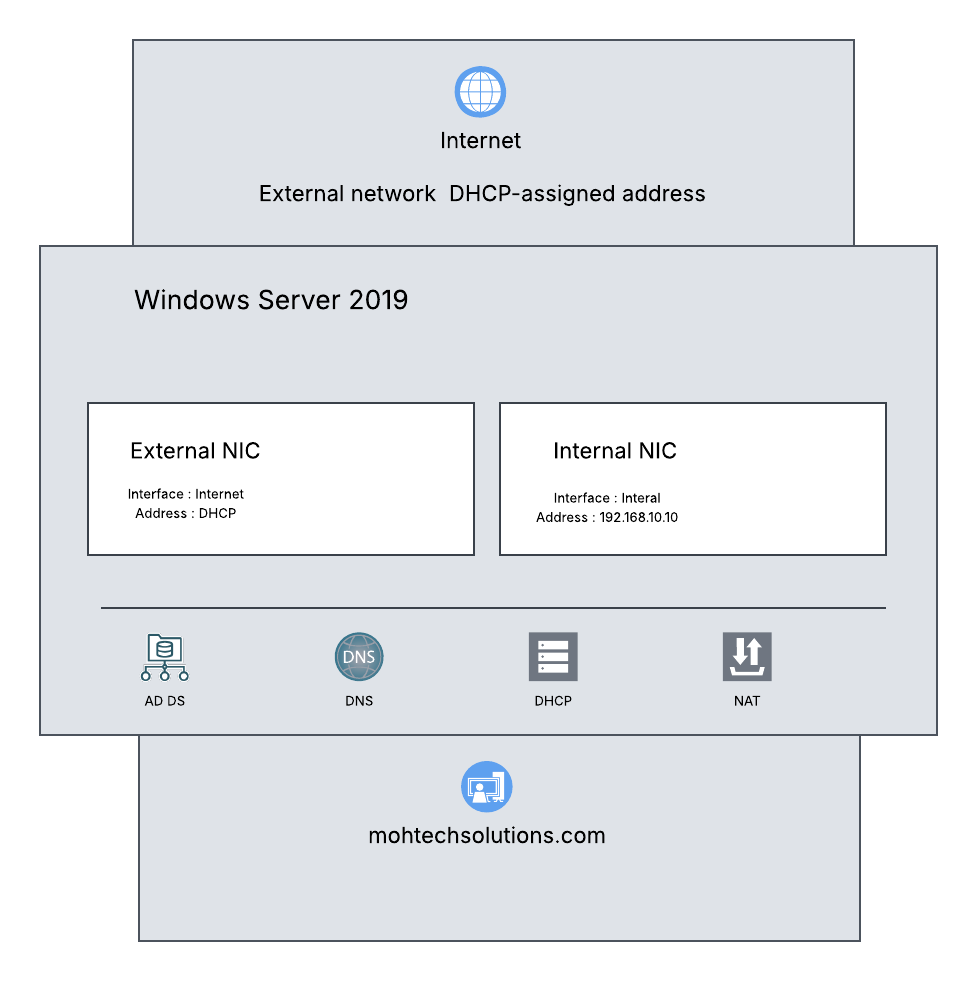
  
<em>Figure 1. Lab Network Topology</em>

---

## 03. Infrastructure Implementation

### 3.1 Server Network, NAT & DHCP Configuration

- Configured `MOH-DC01` with two network adapters: `Internal` (`192.168.10.10/24`) for the corporate LAN and `Internet` (`192.168.1.16/24`) for external uplink.
- Configured **Routing and Remote Access (RRAS)** with NAT so internal clients can reach external networks.
- Installed and configured the **DHCP Server** role with an active IPv4 scope (`192.168.10.100 – 192.168.10.200`).

**Server Dual-NIC IP Configuration**

  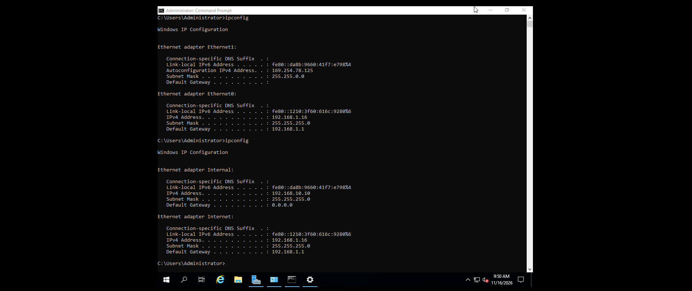

**Routing and Remote Access (NAT)**

  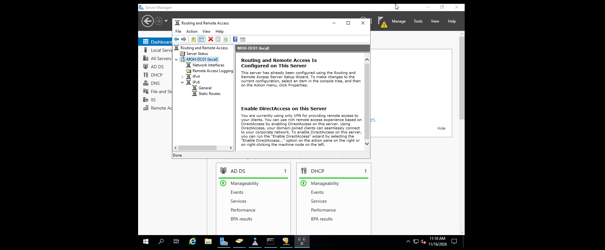

**DHCP Server Scope Configuration**

  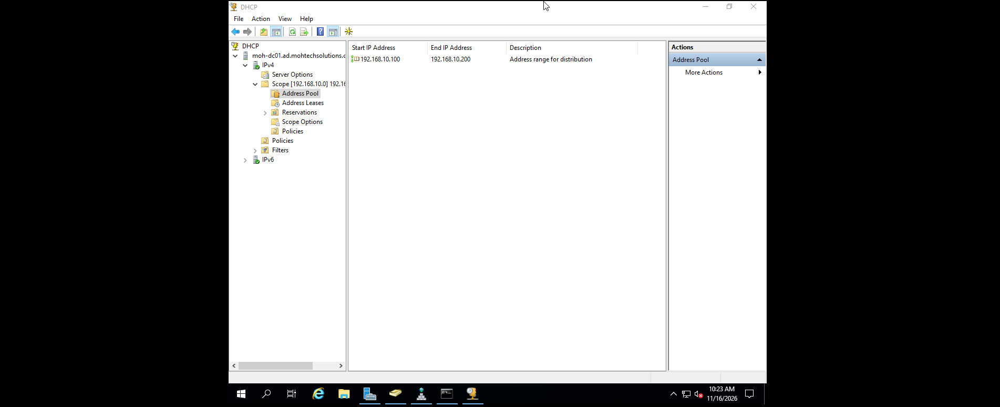

---

### 3.2 Active Directory & Domain Join

- Installed **Active Directory Domain Services (AD DS)** and promoted `MOH-DC01` to establish the `ad.mohtechsolutions.com` forest and domain.
- Automated bulk Active Directory user account provisioning into the `_EMPLOYEES` Organizational Unit using a custom PowerShell script (`Generate-Names-Create-Users.ps1`).
- Joined the Windows 10 workstation (`MOH-CL01`) to the `ad.mohtechsolutions.com` domain.

**Active Directory Users and Computers (`ad.mohtechsolutions.com`)**

  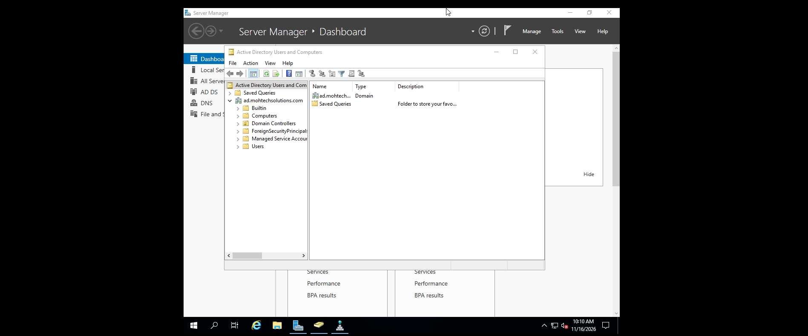

**PowerShell Automated User Provisioning**

  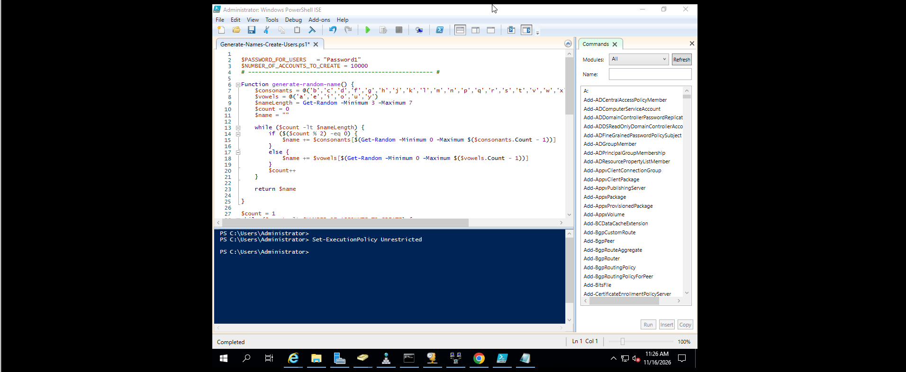

**Provisioned Active Directory Users (`_EMPLOYEES` OU)**

  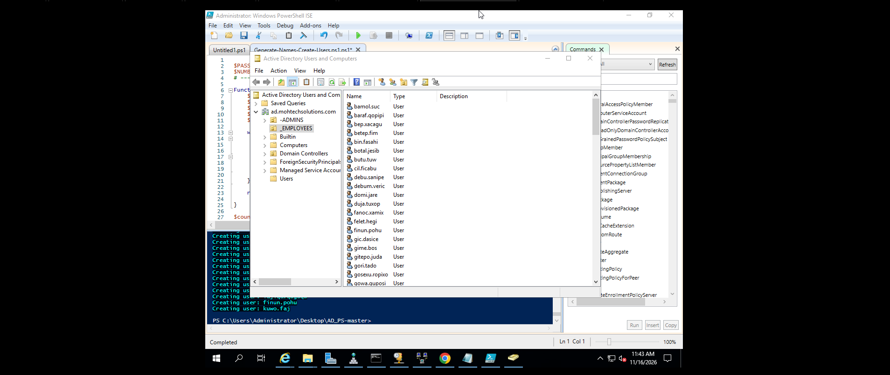

**Client Domain Join (`MOH-CL01`)**

  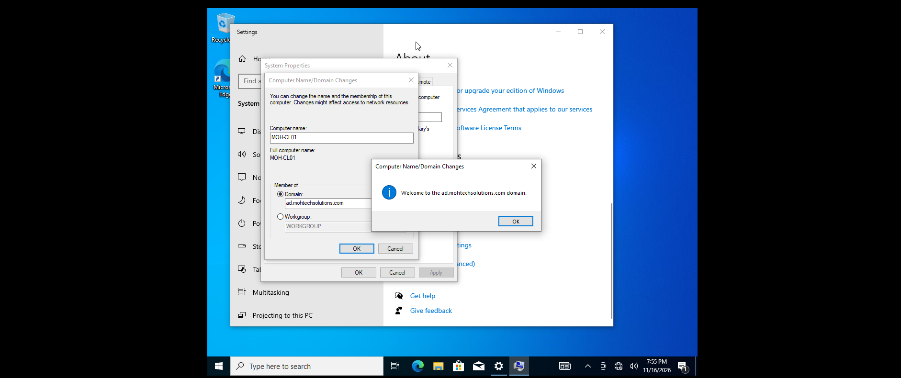

---

### 3.3 Client Network, DNS & NAT Verification

- Verified that `MOH-CL01` automatically leased `192.168.10.100` from `MOH-DC01` with the domain DNS suffix `ad.mohtechsolutions.com`.
- Validated internal DNS resolution (`nslookup ad.mohtechsolutions.com`) and local connectivity to the domain controller.
- Authenticated as a domain user (`mohtech\a-mbenouis`) and verified outbound internet connectivity (`ping google.com`) routed through `MOH-DC01`.

**Client DHCP Lease & Internal DNS Resolution**

  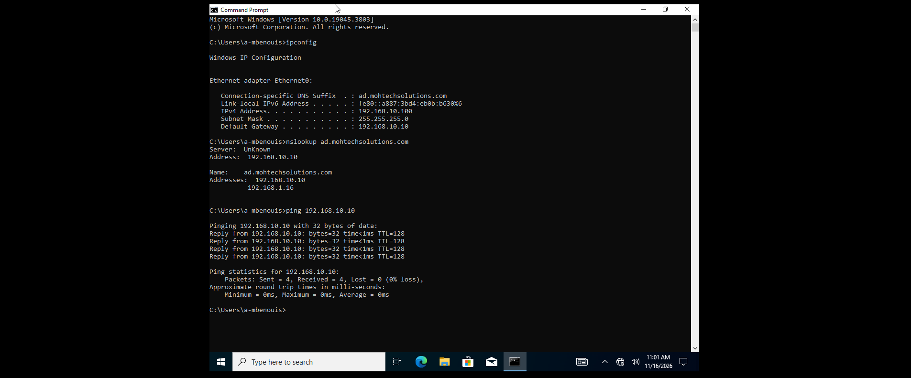

**Domain Authentication & Outbound NAT Connectivity**

  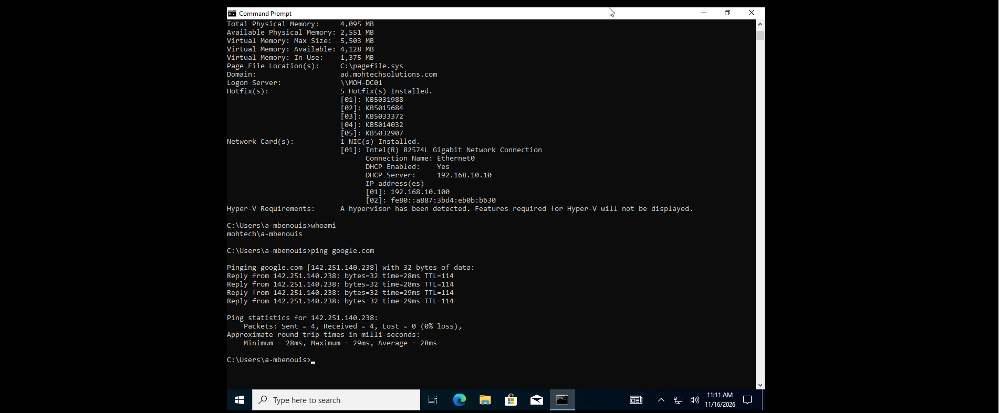

---

### 3.4 Departmental File Sharing & Access Control

- Created centralized departmental directories under `C:\CompanyShares` (`HR`, `IT`, and `Sales`) on `MOH-DC01`.
- Configured SMB share and NTFS permissions to restrict access strictly to authorized departmental security groups.
- Verified least-privilege enforcement by confirming an unauthorized HR user is denied access to `\\MOH-DC01\it`.

**Departmental Shared Directories (`C:\CompanyShares`)**

  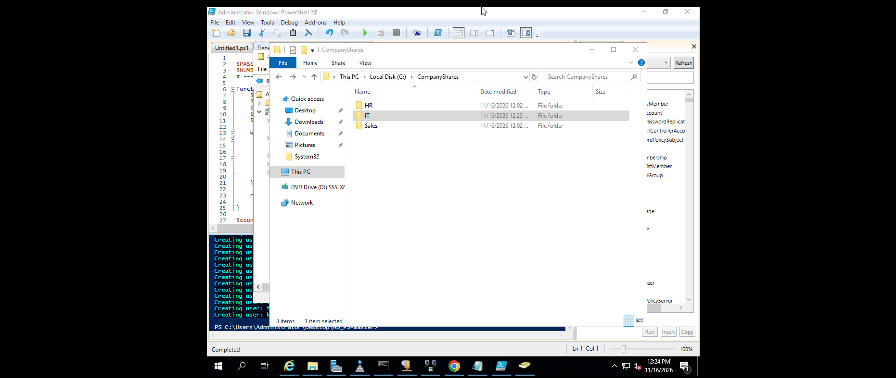

**Access Control Verification (Access Denied to Unauthorized Share)**

  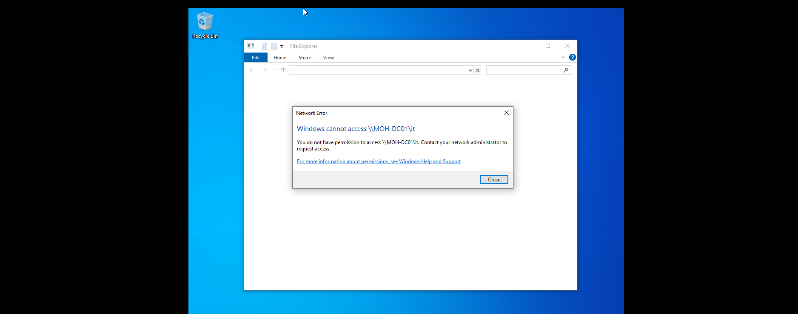

---

### 3.5 Group Policy Management

- Created and linked a custom computer GPO (`MOHTECH- Workstation Inactivity Lock`) configuring **Interactive logon: Machine inactivity limit** to **600 seconds (10 minutes)**.
- Verified policy deployment on `MOH-CL01` using `gpresult` to confirm the GPO was successfully applied from `MOH-DC01.ad.mohtechsolutions.com`.

**Inactivity Lock Policy Configuration (GPMC)**

  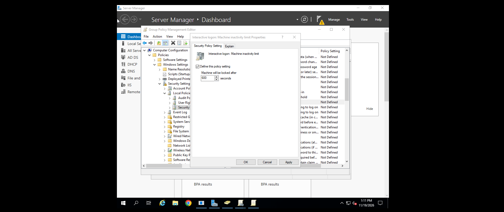

**Client GPO Application Verification (`gpresult`)**

  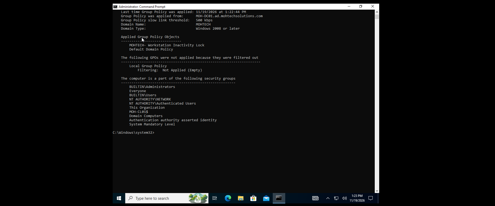

---

## 04. Verification & Testing Summary

- **Network & Routing:** Verified DHCP lease assignment (`192.168.10.100`), internal DNS resolution (`192.168.10.10`), and outbound internet translation via RRAS NAT.
- **Access Control:** Tested cross-department share access from a client session to confirm unauthorized users receive an `Access Denied` error (`\\MOH-DC01\it`).
- **Policy Enforcement:** Audited applied computer policies via `gpresult` to confirm `MOHTECH- Workstation Inactivity Lock` applies cleanly to domain workstations.

---

## 05. Skills Demonstrated

- Windows Server 2019 Administration (`MOH-DC01`)
- Active Directory Domain Services (`ad.mohtechsolutions.com`) & Domain Joins
- Group Policy Management (GPMC) & `gpresult` Auditing
- DHCP Scope & Internal DNS Administration
- Dual-NIC Routing & Remote Access (NAT)
- SMB & NTFS Access Control Lists (ACLs)
- PowerShell User Provisioning Automation
